# Windows 本地部署 Hermes Agent：接入智谱 GLM，实战生成 AI 新闻周报

> 本文基于 Windows 实操截图与实际任务整理，资料核查日期为 2026 年 10 月 23 日。不同版本的界面与菜单顺序可能变化。

让 AI 整理最近一周的新闻，通常会得到一段回答。如果还想把结果做成网页、保存到电脑，再打开查看，就需要继续复制内容、创建文件。

这次换一种做法：在 Windows 上安装 Hermes Agent，接入智谱 GLM，直接提出任务，让它搜索新闻并生成本地 HTML。下面按安装、模型配置和实战的顺序展开，配图来自实际操作画面，裁剪与脱敏副本不改变操作结果。

先说明“本地部署”的含义：**Hermes 在本机运行，本文的 GLM 通过智谱国内在线 API 调用。这里没有下载 GLM 模型权重，也不需要在本地显卡上运行大模型。** 调用模型和联网搜索仍需要网络，API 也可能产生费用。

## 一、Hermes 和常见的 AI 聊天客户端有什么区别

GLM 负责理解问题、规划步骤和生成内容，Hermes 则是让模型使用工具、推进任务的 Agent 运行环境。它可以把搜索、文件读写、终端等工具接入对话，并根据工具返回的结果继续执行。[R14]

本文任务中的实际分工是：

```text
用户提出任务 → GLM 组织搜索请求 → Hermes 调用搜索工具
                                  ↓
用户打开页面 ← Hermes 写入 HTML ← GLM 整理结果与生成内容
```

需要把结果保存成文件、处理本地资料，或者根据工具反馈继续操作时，Hermes 的用途就比较明显：同一段会话可以把任务推进到实际产物。

这里不把其他客户端一概归为“只能聊天”。部分客户端也有联网、文件导出或 Agent 功能，不能据此断言 Hermes 在所有场景下都更强。本文展示的是它在本机连接模型与工具、完成交付的工作方式。

另一个便利是 Desktop 与 CLI 共用 Hermes 的核心和配置：可以在 PowerShell 中配置模型，再回到桌面界面使用。前提是两者连接同一套本地环境和 Profile。[R13]

## 二、准备工作

| 项目 | 本次演示 |
| --- | --- |
| 系统 | Windows 11 |
| 界面 | Hermes Desktop，截图右下角显示 `v0.22.4` |
| 配置入口 | Windows PowerShell 中的 `hermes model` |
| 模型服务 | 智谱国内开放平台，普通标准 API |
| Provider 菜单 | `Z.AI / GLM` |
| API 基础地址 | `https://open.bigmodel.cn/api/paas/v4` |
| 模型 | `glm-5.3-flash` |
| 推理设置 | 配置示例为 `medium`；任务截图显示 `High`，并非全程固定同一档 |

准备一台可联网的 Windows 电脑，以及智谱国内开放平台的标准 API Key。Key 只在本机配置界面输入，不要发给他人，也不要放进博客截图或公开仓库。

GLM-5.3-Flash 的官方资料列有 Function Calling 能力，可用于本次工具调用演示。[R12] 本文不比较模型排行榜，也不把这次任务当作性能或成本测试。

## 三、在 Windows 上安装 Hermes

### 3.1 从官网下载 Windows 安装程序

打开 Hermes 官网：

```text
https://hermes-agent.nousresearch.com/
```

选择 Windows 下载入口，不要误选云端部署入口。

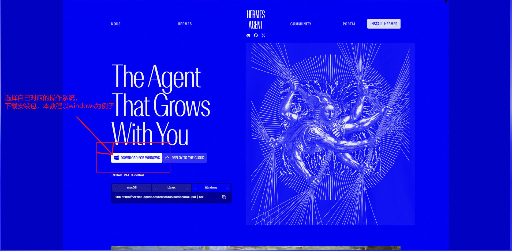

图 1：本次素材中的 Windows 下载页面。

官网的分发方式可能调整。官方区分预打包 Desktop 与会下载、准备运行环境的引导安装器，两种界面不一样。[R01] 本文截图展示的是带 `INSTALL` 按钮的安装启动界面，不将它写成 Windows 系统 App Installer 的窗口。

### 3.2 运行安装器

运行下载的安装程序，在出现下面的界面后点击 `INSTALL`，再按向导完成安装。

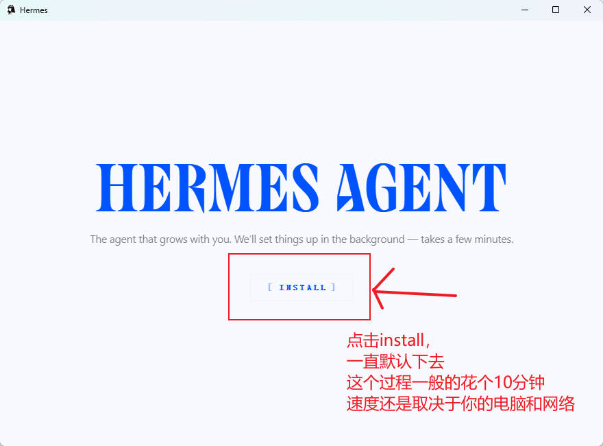

图 2：本次演示的安装入口。原标注中的“10 分钟”不能作为固定安装耗时。

如果向导提供路径等选项，按自己的电脑情况确认，不要把“全部默认”理解为任何机器上都适用。下载和环境准备的耗时受网络与电脑环境影响，本文没有补造未记录的中间安装画面。

如果官网下载后打开的是 Windows App Installer，请按该安装包的提示操作，不必寻找与图 2 完全相同的按钮。

### 3.3 打开 Desktop 和新的 PowerShell 窗口

安装后启动 Hermes Desktop。接着重新打开一个 PowerShell 窗口，让新窗口取得安装后的 PATH 环境，再进行模型配置。[R02]

下面的配置命令都在 **PowerShell** 中输入。Hermes 内部执行终端工具时使用的 Shell 是另一层机制，不要把两者混为一谈。[R02]

## 四、准备智谱国内标准 API Key

### 4.1 登录智谱开放平台

打开智谱国内开放平台并登录自己的账号：

```text
https://bigmodel.cn/
```

如果还没有账号，也可以通过我的邀请链接注册。下面是平台提供的邀请文案：

> 我正在智谱大模型开放平台 BigModel.cn上打造AI应用，智谱新一代旗舰模型 GLM-5.3 已上线， 在推理、代码、智能体综合能力达到开源模型 SOTA 水平，通过我的邀请链接注册即可获得 2000万Tokens 大礼包，期待和你一起在BigModel上畅享卓越模型能力。

[我的智谱邀请注册链接](https://www.bigmodel.cn/invite?icode=6ycxrq%2Fff%2BMIr3EvashK%2BmczbXFgPRGIalpycrEwJ28%3D)

以上为平台邀请活动文案，此链接为作者邀请链接。礼包的领取条件、有效期和适用范围以平台实际活动规则为准。

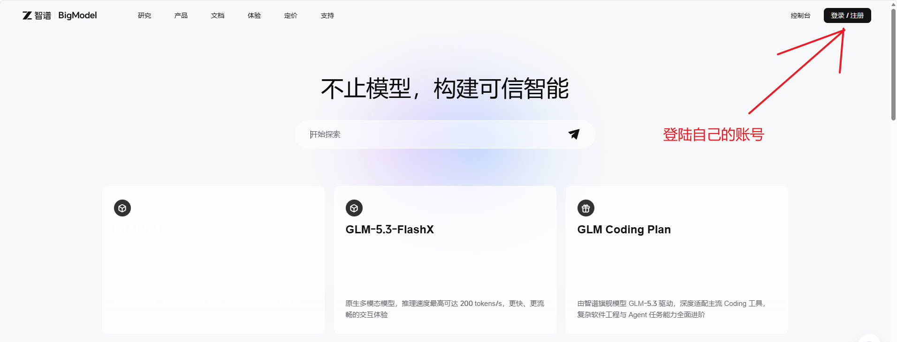

图 3：登录智谱国内开放平台。

进入控制台，找到左侧 `API Key` 入口。

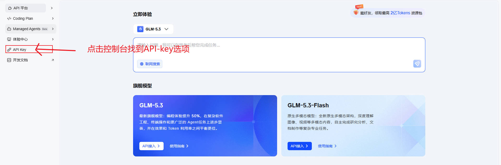

图 4：从控制台进入密钥管理。

### 4.2 创建标准 API Key

本文使用普通 API，而不是 Coding Plan。进入标准 API Key 页面，点击“新增 API Key”，按页面要求创建并妥善保存。

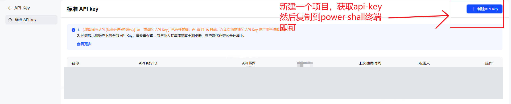

图 5：这里新增的是 API Key，不是额外新建一个项目。已有密钥记录已做不透明遮挡。

智谱官方说明，个人套餐、团队套餐和模型标准 API 的密钥分开管理，新建的不同产品类型密钥互不通用。[R11] 应先确定所用服务，再配置对应 Key 与端点。

普通 API 是否可调用、是否需要余额，以账号权限和平台计费说明为准，本文不承诺注册后即可免费完成全部任务。

## 五、在 Hermes 中配置 GLM

### 5.1 启动模型配置向导

在 PowerShell 中输入：

```powershell
hermes model
```

这是截图中实际使用的配置命令：

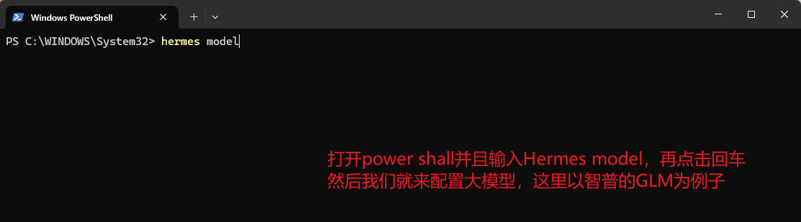

图 6：通过向导配置模型，不需要先手写完整 YAML。

命令输入位置不必和截图中的 `C:\WINDOWS\System32` 一样。后续让 Agent 读写文件前，应明确指定允许使用的任务目录，避免在系统目录下创建文件。

### 5.2 选择 Z.AI / GLM 并输入 Key

在 Provider 列表中按名称找到 `Z.AI / GLM`。

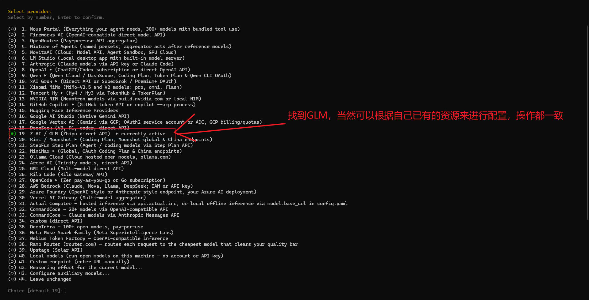

图 7：本次编号为 19，其他版本以名称为准，不要照搬编号。

确认后，终端提示输入 GLM API Key。

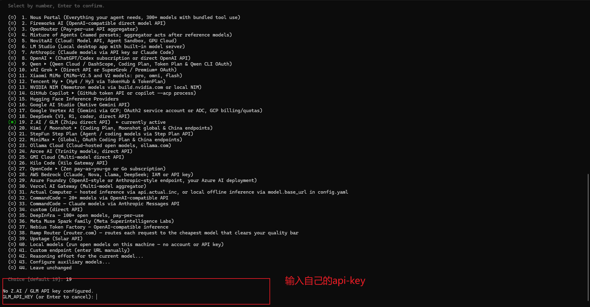

图 8：在本机终端输入或粘贴 Key，按回车继续；不要将它作为聊天内容发送给 Agent。

### 5.3 选择 China 国内端点

密钥保存后，继续选择接入地址。本文使用国内标准 API，因此选 `China`：

```text
China (https://open.bigmodel.cn/api/paas/v4)
```

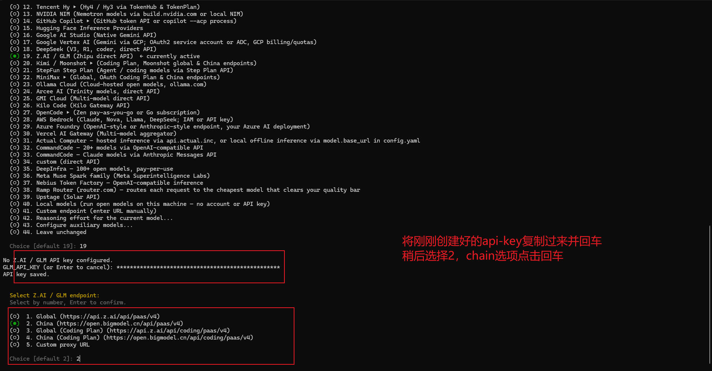

图 9：以实际菜单中的 `China` 为准，原标注的 `chain` 是拼写误写。

配置界面使用基础地址，到 `/api/paas/v4` 为止。智谱 HTTP 调用示例里的完整请求地址包含 `/chat/completions`，不要把两者混淆。[R11]

国际站、国内标准 API 和 Coding Plan 不是同一个接入地址。认证或权限有问题时，一起检查 Key 类型、端点和模型权限，不要只反复更换模型名。

### 5.4 选择模型

选择本次演示使用的 `glm-5.3-flash`。

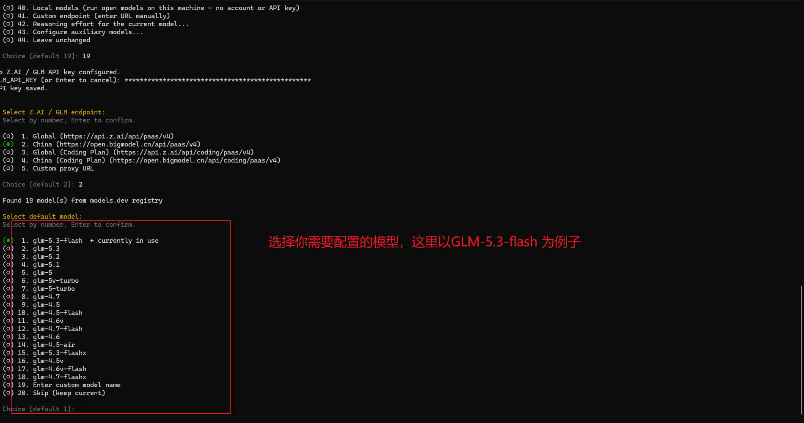

图 10：候选模型及其排序可能随版本与服务权限变化。

同一个模型可能出现在不同平台的列表中，选择时要确认 Provider 和凭据确实属于自己的智谱账号。名称相似不代表走相同平台或额度。

### 5.5 选择推理强度并完成配置

接下来向导显示推理选项。本次配置示例选择 `medium`。

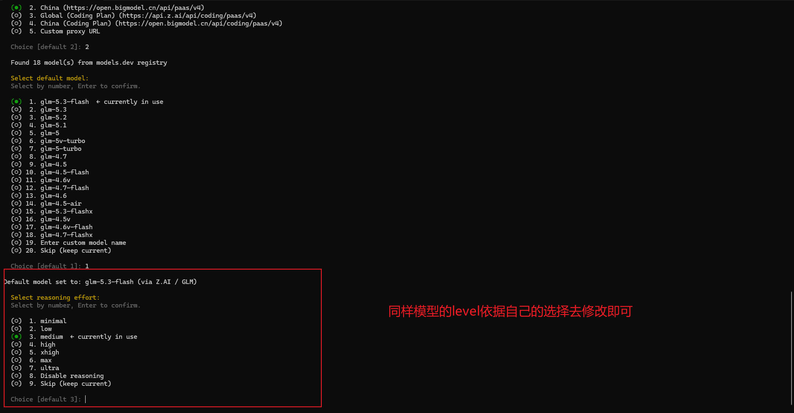

图 11：按模型支持情况选择，不必机械照搬菜单编号。

完成后，可以看到模型与推理设置的确认信息。

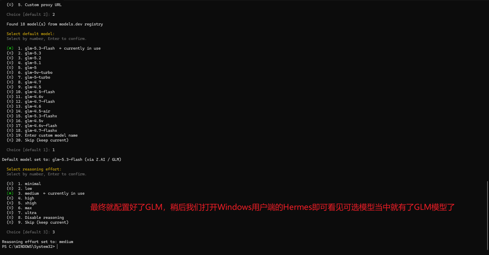

图 12：模型设置为 `glm-5.3-flash`，客户端保存的推理选择为 `medium`。

推理强度不是模型“等级”，也不保证越高就越准确。不同模型的参数支持存在差异，这里展示客户端选择，不将界面选项等同于已核对的服务端请求参数。[R04][R12]

## 六、回到 Desktop，确认使用 GLM

打开 Hermes Desktop，新建会话，在输入框附近确认模型服务与 GLM 型号。

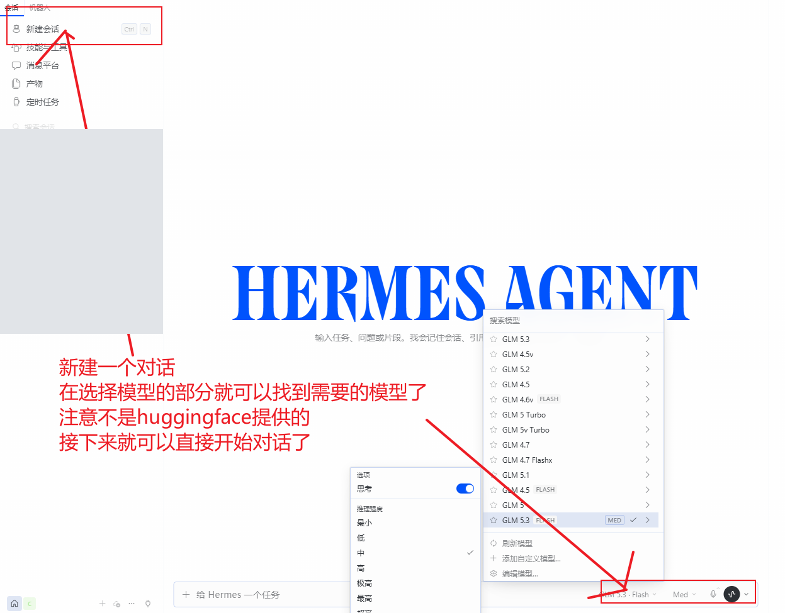

图 13：保留新建会话与模型选择，无关历史列表已遮挡。

CLI 配置后 Desktop 没有预期模型时，先核对两边是否使用相同 Profile、同一个本地后端，再检查当前会话是否保留了旧的模型选择。[R03][R13]

**模型接通不等于联网搜索已经配置好。** 本次案例还依赖搜索工具，工具的可用性取决于相关配置与服务权限。不能认为填入智谱 Key 就自动包含所有搜索服务。可通过下面的命令查看与配置工具：[R14]

```powershell
hermes tools
```

如果搜索不可用，先按当前版本的工具设置提示处理，再开展新闻任务。本文不把某个搜索服务的账号或免费额度当作所有读者默认具备的条件。

## 七、实战：搜索国内 AI 热点，生成 HTML 周报

### 7.1 输入任务

本次实际提示词是：

```text
国内最近7天最热门的有关ai的新闻都有那些，整理成一个html文件
```

它只给出目标和产物格式，没有逐条指定工具。历史会话记录的模型为 `glm-5.3-flash`。

自己复现时，可以补充明确日期、来源要求和保存位置。例如下面是改进提示词，**不是当时原样执行的内容**：

```text
请检索中国相关 AI 热点新闻，检索区间为北京时间
2026年10月17日00:00至2026年10月24日00:00，不含结束时刻。

优先采用官方公告或可追溯报道，分别列出发布日期、事件日期、
标题、摘要和具体原文链接。未证实的消息单独标注，
不要把主观判断写成客观的全网热度排名。

生成可在浏览器打开的单文件 HTML，保存到我指定的<任务目录>，
文件名为 ai-news-weekly.html。只在该目录新增文件；
如同名文件已存在，先询问我再覆盖。
```

实际使用时替换日期和 `<任务目录>`，不要把整个用户目录当作默认工作区。

### 7.2 观察搜索与文件生成

已有会话中，Hermes 分两轮发起搜索。历史工具记录确认四次搜索调用均返回成功，随后调用文件工具生成 HTML。

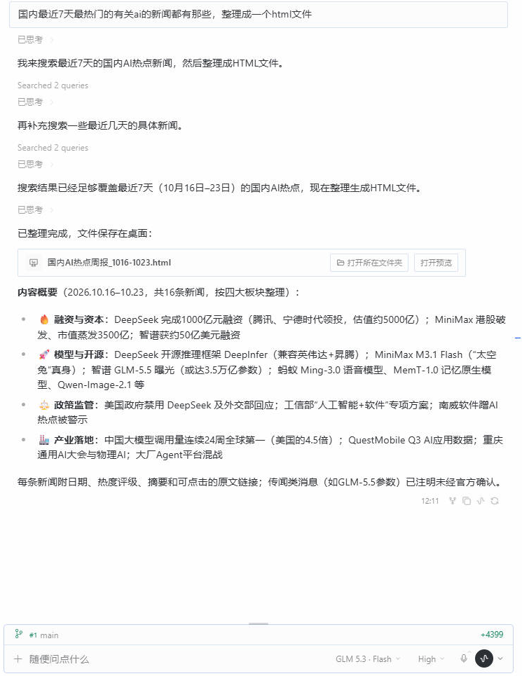

图 14：裁掉左右无关侧栏，保留任务、搜索状态、文件卡片和模型。图中新闻摘要是未逐条核实的模型输出。

这里能看到 Hermes 和只输出操作建议的区别：搜索结果进入后续处理，HTML 被写入电脑，再以文件卡片交付。

本次产物保存在桌面，文件名为：

```text
国内AI热点周报_1016-1023.html
```

文件写入工具返回 `verified: true`。写作阶段又实际读取了该文件，确认产物存在，没有只引用助手说“已完成”的一句话。

任务截图显示 `High`，配置示例显示 `medium`。这些画面来自不同状态，不宣称任务全程固定为 `medium`，也不将截图文件名的时间当作每个步骤的实际执行时间。

### 7.3 查看 HTML 页面

点击文件卡片的预览入口，或在本地目录使用浏览器打开 HTML。


图 15：从用户提供的实际预览截图裁取页面，未重新生成页面，也未改动新闻文字。仅展示产物形态，不作为已核实的新闻报告。

文件分为融资与资本市场、模型发布与技术开源、政策与监管、产业落地与生态四个板块，有卡片式摘要和来源链接。本地检查统计到 17 张新闻卡片。

本次 HTML 为未逐条校对的自动生成示例，用于展示任务交付方式，不作为可靠的新闻报告或公开下载附件。

### 7.4 交付后检查结果

本次结果也存在需要人工复核的地方：

- 对话称“16 条”，文件实际有 17 张新闻卡片，应以文件检查结果为准。
- 页面标注 2026 年 10 月 16 日至 23 日。两日期相差七天，但若首尾均计入，则涉及八个自然日，“最近 7 天”最好写成明确的起止时刻。
- 部分来源仅指向网站首页，不能直接支撑具体新闻；“热度”也没有可复核的统一统计方法。

这些问题不影响确认文件已经生成，但影响内容能否直接发布。本文没有逐条核实新闻和融资数字，不把生成页面作为可靠的新闻事实来源。

复现时先确认文件存在、能打开，再检查日期、原文与摘要对应关系。自动化省下了搜索和制作文件的手工步骤，事实核对仍需要人参与。

## 八、几个容易卡住的地方

### PowerShell 提示找不到 hermes

关闭旧窗口，重新打开 PowerShell，再试 `hermes model`。仍找不到时，检查安装是否提供 CLI 入口及对应 PATH 说明，不从网上随便复制另一种安装方式的路径。[R01][R02]

### 有 Key，仍然认证失败

核对是否为标准 API Key、是否选择 `China`、粘贴是否多了空白，以及账号是否有模型权限。日志与截图不要包含真实 Key。[R11]

### 模型能聊天，但搜索失败

模型服务与搜索工具是两条依赖。检查工具是否启用、服务是否可用，不要用模型记忆冒充最新搜索结果。[R14]

### CLI 配好后，Desktop 还是旧模型

核对 Profile、后端连接和当前会话的模型选项。同一台电脑上也可能存在多套环境，不要反复在不同目录写入密钥。[R03][R13]

## 九、总结

这次任务走完了 Windows 安装、智谱国内 GLM 配置、搜索新闻与本地 HTML 交付的流程。模型负责理解与组织，Hermes 的工具负责取回信息和写入文件，用户拿到可以打开的产物。

对需要把问答接到本地工作流程的人，这比停留在操作建议更实用。但产物能打开、工具返回成功和内容完全准确是不同的验收项。建议从单独的任务目录开始，保留重要操作确认，检查结果后再扩大自动化范围。

## 参考资料

这些资料支持安装、模型与工具机制，不作为演示周报新闻条目的核验依据。

- [R01] [Installation](https://hermes-agent.nousresearch.com/docs/getting-started/installation)
- [R02] [Windows Native Guide](https://hermes-agent.nousresearch.com/docs/user-guide/windows-native)
- [R03] [Profiles](https://hermes-agent.nousresearch.com/docs/user-guide/profiles)
- [R04] [Configuration](https://hermes-agent.nousresearch.com/docs/user-guide/configuration)
- [R11] [智谱快速开始](https://docs.bigmodel.cn/cn/guide/start/quick-start)
- [R12] [GLM-5.3-Flash/FlashX](https://docs.bigmodel.cn/cn/guide/models/vlm/glm-5.3-flash.md)
- [R13] [Hermes Desktop](https://hermes-agent.nousresearch.com/docs/user-guide/desktop)
- [R14] [Tools & Toolsets](https://hermes-agent.nousresearch.com/docs/user-guide/features/tools)

[R01]: https://hermes-agent.nousresearch.com/docs/getting-started/installation
[R02]: https://hermes-agent.nousresearch.com/docs/user-guide/windows-native
[R03]: https://hermes-agent.nousresearch.com/docs/user-guide/profiles
[R04]: https://hermes-agent.nousresearch.com/docs/user-guide/configuration
[R11]: https://docs.bigmodel.cn/cn/guide/start/quick-start
[R12]: https://docs.bigmodel.cn/cn/guide/models/vlm/glm-5.3-flash.md
[R13]: https://hermes-agent.nousresearch.com/docs/user-guide/desktop
[R14]: https://hermes-agent.nousresearch.com/docs/user-guide/features/tools
