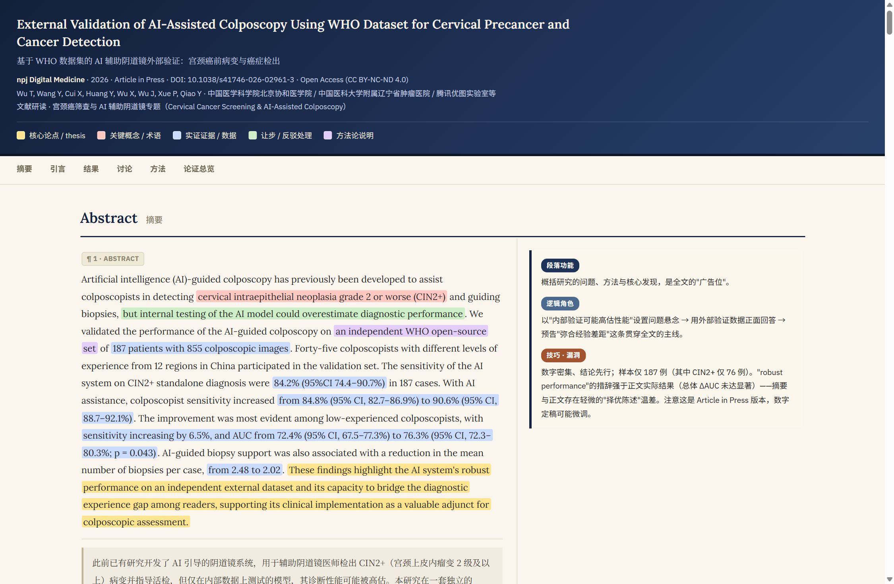
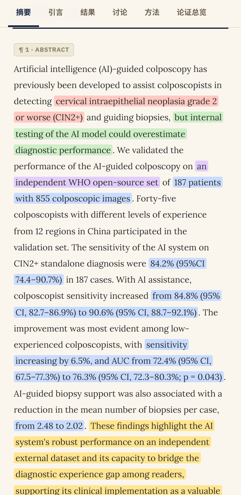
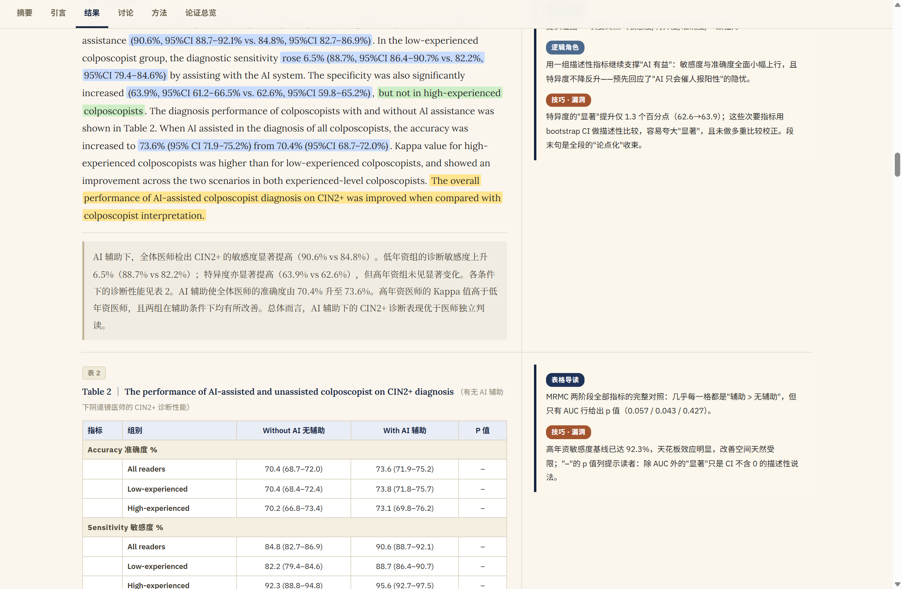
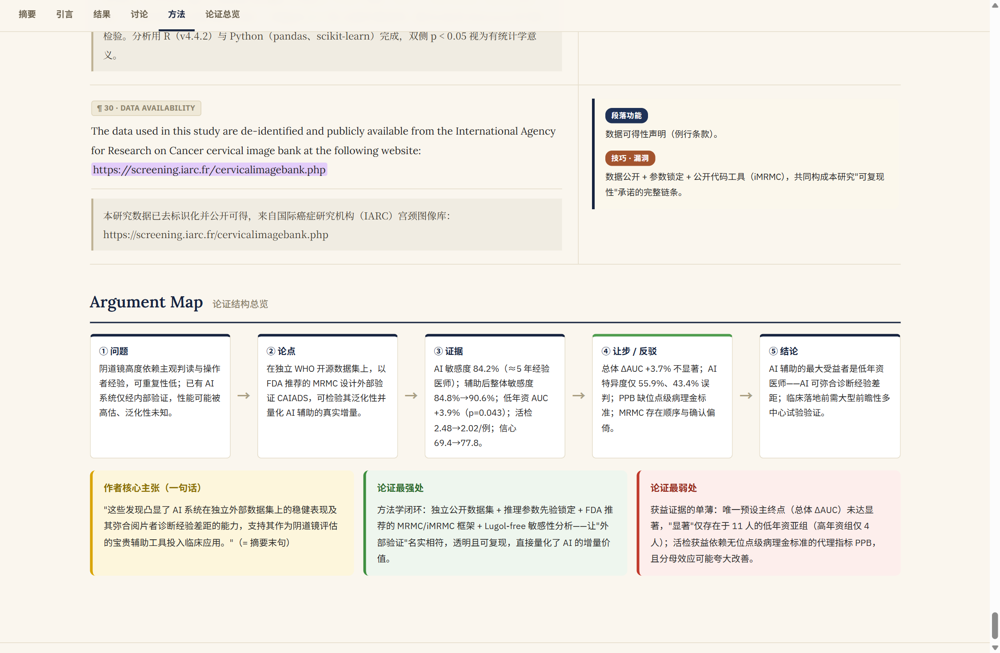

# 把"读论文"做成一个 Skill：让 Claude / Codex 生成英中双栏批注 HTML

## 一、问题与动机：为什么"总结论文"不够用

实验室里的本科生和研究生，入门阶段最常见的任务就是读英文论文。但多数人读论文的方式是让大模型"帮我总结一下这篇论文"——得到的往往是一份要点罗列：方法是什么、结果是什么、结论是什么。这种总结丢失了论文最核心的东西：**论证结构**。

一篇实验性论文真正值得学的，是作者怎么组织论证：引言里哪句话是核心论点、哪句话在埋伏笔；结果部分哪个数字支撑了哪句主张；讨论部分作者怎么处理自己的软肋、怎么让步再反驳。这些结构性的东西，逐段读原文才能体会到，而"总结"恰恰把它抹平了。

另一个现实问题是语言。逐段读英文原文费时，直接读中文翻译又会失去原文的措辞——而学术论文的措辞本身就是信息（比如 "associated with" 和 "demonstrates" 的证据强度完全不同）。理想的阅读材料应该是：**左边英中对照，右边逐段批注，批注专门指出这段在论证链里干什么**。

市面上的工具没有现成满足这个需求的，于是我把这套阅读法写成了一个 Agent Skill——`paper-annotate`。输入是一篇论文 PDF，输出是一个**单文件 HTML 双栏批注页面**。本文记录这个 skill 的完整设计、实现、跨 Claude Code 与 Codex 的适配方式，以及一个真实的使用实例。skill 会整理后开源，仓库地址届时更新到本文。

## 二、输出形态：不是摘要，是"论证结构批注页"

先看产出长什么样。以一篇 npj Digital Medicine 2026 年的论文为例（基于 WHO 数据集的 AI 辅助阴道镜外部验证研究，DOI: 10.1038/s41746-026-02961-3），`paper-annotate` 生成的页面包含四个部分：

**1. 顶部导航栏**：论文标题、期刊信息、DOI，以及五种颜色的图例——这是全文的分析维度约定：

| 颜色 | 维度 | 标注什么 |
|------|------|----------|
| 黄色 | 核心论点 / thesis | 作者真正想证明的那句话 |
| 红色 | 关键概念 / 术语 | 首次出现的专业概念 |
| 蓝色 | 实证证据 / 数据 | 支撑论点的具体数字 |
| 绿色 | 让步 / 反驳处理 | 作者承认局限、回应质疑的句子 |
| 紫色 | 方法论说明 | 研究设计、统计口径 |

**2. 章节导航条**：sticky 定位，点击跳转到 Abstract / Introduction / Results / Discussion / Methods 各节，滚动时自动高亮当前章节。

**3. 主体双栏**：左栏是英中双语对照——英文原文（衬线字体）按五色高亮标注，下方紧跟浅米色背景的中文意译；右栏是逐段批注卡片，每段固定回答三个问题：这段的**功能**是什么（引出问题/提供证据/反驳异议）、它在**论证链里的角色**是什么、有哪些值得注意的**论证技巧或潜在漏洞**。

**4. 底部论证地图**：一行的逻辑骨架（问题 → 论点 → 证据 → 让步/反驳 → 结论），加上"作者核心主张一句话""论证最强处""论证最弱处"三张卡片。

实际效果如下（截图均为 skill 真实生成页面的实拍，不是示意图）：



移动端自动降级为单栏布局，五色高亮和中文译文块保持完整：



第三部分的"漏洞"批注是我认为最有价值的一块。以那篇阴道镜论文为例，页面会直接指出：摘要写 "robust performance"，但正文里预设的主终点（总体 ΔAUC）其实没有达到统计显著，显著只出现在低年资亚组——摘要与正文存在"择优陈述"的温差。这种批判性视角恰恰是研究生读文献时最需要训练、也最容易被"总结式阅读"跳过的。

完整实例文件会随开源仓库一并放出。

## 三、SKILL.md：skill 的完整实现

Agent Skills 是一个开放标准（agentskills.io），Claude 和 Codex 都支持：一个 skill 就是一个文件夹，里面必须有一个 `SKILL.md`，frontmatter 中 `name` 和 `description` 是必填项。两个产品的加载机制都是"渐进式披露"——平时只把 name 和 description 放进上下文，判断任务匹配后才读取完整指令，所以 description 写得好不好直接决定 skill 会不会被正确触发。

`paper-annotate` 的完整 SKILL.md 如下，可直接复制使用：

```markdown
---
name: paper-annotate
description: 学术论文双栏批注 HTML 生成器。将一篇学术论文（PDF）制作为英中双语对照 + 逐段中文批注的单文件 HTML，按五类维度（核心论点/关键概念/实证证据/让步反驳/方法论）高亮论证结构，并附论证结构总览。触发场景：用户要求"批注这篇论文""做双语批注页面""把论文做成双栏批注 HTML""阅读总结成批注页面"。
---

# 学术论文双栏批注 HTML 生成

给定一篇学术论文（通常是 PDF），生成**单个 .html 文件**，放在该文献的专属文件夹内（与 PDF 同目录），重点呈现论文的论证结构与逻辑层次。

## 工作流程

1. 定位文献专属文件夹与其中的 PDF。
2. 用 Python + PyMuPDF(fitz) 提取 PDF 全文；Windows 下注意输出编码：`sys.stdout.reconfigure(encoding='utf-8')`。
3. 通读全文，识别章节结构（Abstract / Introduction / Results / Discussion / Methods 等）与每一段的功能。参考文献列表不进入逐段批注（可省略）。
4. 按下方规范产出 HTML。
5. 生成后必须用浏览器预览验证（sticky 导航、双栏对齐、五色高亮、移动端响应式），发现问题即修复。

## 文件要求

输出单个 .html 文件，包含以下结构：

### 1. 顶部导航栏
- 标题：论文名 + 课程/研读信息
- 颜色图例，对应以下分析维度：
  - 黄色 = 核心论点/thesis
  - 红色 = 关键概念/术语
  - 蓝色 = 实证证据/数据
  - 绿色 = 让步/反驳处理
  - 紫色 = 方法论说明

### 2. 章节导航条（sticky，可跳转各节）

### 3. 主体内容：左右双栏布局

**左栏：英中双语对照**，每段按以下顺序呈现：
- ① 英文原文（Lora 衬线字体），按五类维度高亮标注关键内容
- ② 中文译文（紧接在英文段落下方，浅米色背景块 + 左侧细竖线，与英文区分）
  - 意译为主，读起来像中文学术论文
  - 不逐字直译，保持中文表达流畅
  - 不加颜色高亮，保持干净
- 英中之间用 1px 细分隔线隔开

**右栏：中文批注（逐段对应）**，每段批注包含：
- ① 段落功能（如：引出问题/提供证据/反驳异议/总结）
- ② 逻辑角色（该段在整体论证链中的位置）
- ③ 值得注意的论证技巧或潜在漏洞

### 4. 底部论证结构总览
- 全文逻辑骨架（问题→论点→证据→反驳→结论）
- 作者核心主张一句话版本
- 论证最强处 vs 最弱处各一条

## 设计风格
- 深海军蓝导航栏 + 米白纸张底色
- 五类维度分色高亮
- 字体：正文 Lora（Google Fonts CDN，衬线回退 Georgia），界面 IBM Plex Sans（回退系统无衬线）
- 中文译文块：浅米色背景 #f0ece2 + 左侧细竖线，与英文原文视觉区分，同属左栏
- 批注卡片：左色边 + 浅背景
- 响应式（移动端单栏，媒体查询降级）
- 单文件：CSS 内联，段落设锚点 id 供导航跳转
```

整个文件不到 60 行，但有几个刻意的设计决策值得展开。

### 3.1 description 里显式枚举触发语

description 的后半段直接写了用户会说的话："批注这篇论文""做双语批注页面""把论文做成双栏批注 HTML"。因为隐式触发完全依赖模型对 description 的匹配，与其期望模型自己泛化"批注"的含义，不如把真实触发场景写进去。注意 description 控制在一行内——按标准要求，name 和 description 都不能有换行。

### 3.2 把"输出长什么样"写成硬性规范

这是整个 skill 最重要的一段。没有规范时，模型每次生成 HTML 的结构、配色、栏目都会随机漂移；写死"双栏布局、五色图例、右栏三问、底部论证地图"之后，每篇论文产出的页面结构完全一致。这一点对使用体验的影响是质变的：**批注页面可以积累成个人文献库**——所有论文的阅读界面长一个样，切换论文时不需要重新适应。

配色和字体也一并钉死（海军蓝 + 米白纸张、Lora + IBM Plex Sans）。这既是为了美观稳定，也是为了让"黄色 = 论点、绿色 = 让步"这套颜色语义在所有页面之间保持一致。

### 3.3 译文规范：意译、不加高亮

左栏的中文译文有三条明确约束：意译为主、保持中文流畅、**不加颜色高亮**。第三条很容易被忽略——如果不禁止，模型会把高亮标记一并复制进译文，五色块在中文里重复一遍只会干扰阅读。英文原文负责承载结构标注，中文译文负责干净易读，两者职责分离。

### 3.4 强制"生成后预览验证"

工作流程第 5 步要求生成后必须用浏览器打开验证：sticky 导航是否生效、双栏是否对齐、五色高亮是否正常、移动端断点是否可用。LLM 写 HTML 的常见失败模式是"语法正确但视觉不对"——比如 grid 列宽写错导致双栏挤压、高亮 span 跨段落断裂、`box-decoration-break` 漏写导致换行处高亮块难看。不验证的 HTML 生成流程，交付物里一定混着视觉残次品。

### 3.5 PDF 提取与 Windows 编码坑

PDF 文本提取用 PyMuPDF（`import fitz`），这是目前对学术 PDF 版面还原最好的 Python 库之一。SKILL.md 里专门写了一句 Windows 提醒：`sys.stdout.reconfigure(encoding='utf-8')`——Windows 控制台默认编码不是 UTF-8，直接 `print` 提取出的论文文本（含大量特殊字符、希腊字母、上标符号）会抛 `UnicodeEncodeError` 或者静默替换成乱码。这条警告出现在 skill 文本里，说明这类问题在实际使用中确实出现过；提前写进规范，模型每次都会主动处理，不需要现场踩坑再修。

另一个 PDF 提取的固有问题：双栏排版的论文按文本流顺序提取时可能左右栏交错。好在工作流程第 3 步要求"通读全文、识别章节结构与段落功能"，模型对明显交错的段落有较强的重排能力；遇到版面特别复杂的 PDF，建议先人工检查提取文本再进入生成环节。

## 四、跨 Claude 与 Codex 安装

因为 SKILL.md 遵守的是 Agent Skills 开放标准（frontmatter 只依赖 `name` + `description`），同一个文件夹不需要任何修改就能在两个引擎中使用，区别只在安装路径和触发方式（以下依据官方文档，2026-11-12 查询）：

| | Claude Code | Codex CLI |
|------|------|------|
| 个人级 | `~/.claude/skills/paper-annotate/` | `~/.agents/skills/paper-annotate/` |
| 项目级 | `.claude/skills/paper-annotate/` | `.agents/skills/paper-annotate/` |
| 显式触发 | 对话中点名使用 | `/skills` 面板，或 `$paper-annotate` |
| 隐式触发 | 请求匹配 description 时自动加载 | 同左 |

安装（Windows 下 `~` 即 `C:\Users\<用户名>`，git-bash 中可直接使用）：

```bash
# Claude Code：把 skill 文件夹放到个人 skills 目录
mkdir -p ~/.claude/skills/paper-annotate
cp /path/to/paper-annotate/SKILL.md ~/.claude/skills/paper-annotate/

# Codex：放到 .agents/skills
mkdir -p ~/.agents/skills/paper-annotate
cp /path/to/paper-annotate/SKILL.md ~/.agents/skills/paper-annotate/
```

PDF 解析依赖（Python 环境里执行一次）：

```bash
pip install pymupdf
```

之后把论文 PDF 放进一个专属文件夹，对模型说"把这篇论文做成双栏批注 HTML"即可。生成的 HTML 会放在 PDF 同目录下，方便论文和批注页长期配套保存。

一个使用上的差别值得知道：Codex 对 description 有长度压缩机制（技能多时会优先缩短 description 甚至省略部分技能），所以 description 的关键触发词尽量前置；Claude Code 侧没有这个问题，但同样建议 description 保持"先说干什么、再说什么时候触发"的顺序。

## 五、真实实例：一篇 npj 论文的批注过程

实例论文：*External Validation of AI-Assisted Colposcopy Using WHO Dataset for Cervical Precancer and Cancer Detection*（npj Digital Medicine，2026，Article in Press，开放获取 CC BY-NC-ND 4.0）。这是一篇典型的临床 AI 外部验证研究：187 例患者、855 张阴道镜图像、45 名不同经验水平的阴道镜医师参与 MRMC 多阅片者多病例研究。

生成的批注页对这篇论文的处理（以下内容均可在生成的批注页中逐条核对）：

- 全文 30 个段落逐段批注，参考文献列表按要求排除；
- 摘要段的高亮直接暴露了论证温差：黄色标出 "These findings highlight the AI system's robust performance..." 这句核心主张，绿色标出 "but internal testing of the AI model could overestimate diagnostic performance" 的让步句，右栏批注则指出样本仅 187 例（其中 CIN2+ 只有 76 例），"robust" 的措辞强于正文实际结果；
- 结果部分每张表格配"表格导读"批注，例如指出表 2 中只有 AUC 行给出了 p 值（0.057 / 0.043 / 0.427），其余指标的"显著"只是置信区间不含 0 的描述性说法，未做多重比较校正；
- 方法部分标出了模态不对称的细节（AI 推理只用醋酸图像、医师判读可加碘染图像），以及对应的 Lugol-free 敏感性分析为何存在——这类"表格里看不出来、必须读 Methods 才知道"的口径差异，正是双栏批注页相对总结类工具的差异化价值；
- 底部论证地图把全文压缩成一行：问题（内部验证可能高估）→ 论点（独立 WHO 数据集 + MRMC 外部验证）→ 证据（敏感度 84.2%、低年资 AUC +3.9%）→ 让步（总体 ΔAUC 不显著、特异度仅 55.9%）→ 结论（低年资医师获益最大，需前瞻性试验验证）。

两张局部截图——结果区的对照表批注与页面底部的论证地图：





一个需要如实说明的点：右栏的"技巧 · 漏洞"批注是模型生成的批判性分析，属于**辅助思考的线索而非定论**。实例页面本身也在页脚声明了这一点（批注是读者的批判性分析，不代表论文作者观点；中文译文为意译，以英文原文为准）。用它来发现"哪里值得多想一步"非常有效，但把它当成论文评价的最终结论是不对的。

## 六、踩坑与局限

整理至今遇到或预见到的问题，按重要程度排列：

1. **Windows 控制台编码**：PDF 提取文本直接 print 会遇到编码错误，解法已固化进 SKILL.md（`sys.stdout.reconfigure(encoding='utf-8')`）。这是所有在 Windows 上做文本处理的 skill 都值得抄走的一条。
2. **长论文的上下文消耗**：一篇 30 页论文全文提取后约几万字符，逐段批注要求模型"看到"全部内容。上下文窗口较小的模型会出现后半部分批注质量下降或段落遗漏。建议用长上下文模型跑这个 skill（具体损耗数字未做系统测量，此处为使用体感）。
3. **译文与批注的准确性边界**：意译的中文译文可能有术语翻译不当；"漏洞"批注可能误读论文（例如把作者已澄清的问题当成漏洞）。批注页的正确用法是"带着问题回到原文"，而不是替代精读。
4. **Article in Press / 预印本陷阱**：早期在线版本的数字可能在高定稿时调整，实例页面的页脚专门加了"引用请以最终出版版本为准"的提示。这个坑不解决，批注笔记可能记下一组后来被修改的数据。
5. **视觉验收不能省**：HTML 一次生成通过全项视觉检查的概率并不高（未做系统统计），浏览器预览这一步在实际使用中反复挽救过布局问题——它写在流程里不是形式主义。
6. **字体依赖 CDN**：Lora / IBM Plex Sans 走 Google Fonts CDN，离线环境打开页面会回退到系统衬线字体，排版略有差异但功能不受影响（CSS 里已做回退声明）。

## 七、小结与开源计划

`paper-annotate` 做的事情可以概括成一句话：**把一种"逐段论证分析"的阅读方法论，固化成一个 LLM 可以稳定复现的输出规范**。它验证了一个做 skill 的通用思路——当你希望模型稳定地产出某类结构化成果时，与其在对话里反复描述需求，不如把输出形态、质量约束和验证步骤写成一个可复用的 SKILL.md，一次编写，所有论文受益。

后续计划：

- 开源仓库整理中（SKILL.md、示例、安装说明），开源后更新本文补上仓库地址；
- 值得探索的方向：把五色维度做成可配置（不同学科的研究者可能需要不同的论证维度）；为提取出的文本增加版面坐标信息，处理双栏交错更稳；批量处理整个文献文件夹并生成索引页。

对读者来说，这个 skill 最小的复现成本是：复制 SKILL.md 到 `~/.claude/skills/paper-annotate/` 或 `~/.agents/skills/paper-annotate/`，装好 PyMuPDF，然后找一篇最近想读又一直没读的论文试一次。批注页生成出来的那一刻，你会直观看到"总结"和"论证结构分析"的差别。
